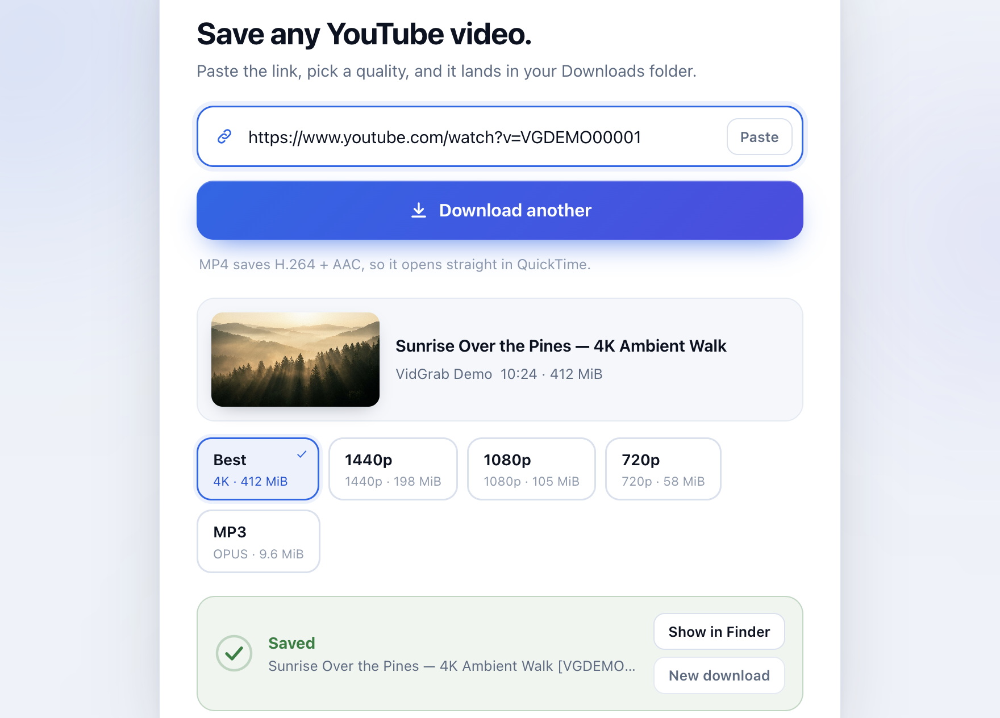

<div align="center">

# VidGrab

**A YouTube downloader with exactly one job.**

One link field. One button. Paste a link, pick a quality, get a file that plays in QuickTime.

[Download](#install) · [How it works](#how-it-works) · [Build from source](#build-from-source) · [Troubleshooting](#troubleshooting)


</div>


---

There are a hundred YouTube downloaders. Most of them are a search box for a video
site, a wall of ads, and a bundled toolbar. A few are honest but ugly, and the
command-line ones are honest and ugly in a different way.

VidGrab is the small one: an Electron app whose entire interface is a link field and a
Download button, with a quality row and a progress bar that appear when there is
something to show. No account, no browser extension, no "recommended for you", nothing
phoning home.

It exists because the useful parts of downloading a video — knowing which qualities
actually exist, getting the bytes down fast, and ending up with a file that opens in the
player you already use — are fiddly, and everything wrapping them tends to be noise.

## Screens

| Ready | Downloading | Done |
|:-----:|:-----------:|:----:|
|  |  |  |
| Link read → real qualities listed | Bytes, speed, time left | File on disk, revealed in Finder |

The idle state is just the field and the button:


## What it does

- **Paste a link → it reads the video.** Title, channel, duration, thumbnail, and the
  qualities that genuinely exist for that video. Typing stops for ~0.8 s and the read
  starts on its own, so by the time you press Download the answer is usually already there
  (first byte 0.2–0.8 s after the press).
- **Only downloadable qualities are offered.** The planner resolves each chip against the
  actual format list — a progressive pass first, then an HLS/DASH pass — and a quality it
  cannot deliver never appears as a button. If a video tops out at 240p, 240p is what you
  get; no greyed-out 1080p that fails when pressed.
- **One paste, many files.** The read is cached per video, so grabbing 720p *and* 480p and
  the MP3 doesn't re-extract anything. Each quality saves to its own filename, so the
  second one doesn't overwrite the first.
- **Fast, because it asks for the file in slices.** YouTube serves an open-ended `GET`
  slowly — measured on one 13 MB stream: **24 KiB/s**. The same URL with
  `Range: bytes=0-3299999` served at **1.1–2.4 MB/s**. VidGrab splits the stream into four
  ranged requests and runs them in parallel; that 13 MB arrives in about 6 s. A 176 MB
  1080p video that took over an hour the old way lands in **8.4 minutes**.
- **Speed and time left never disappear.** They hold through pauses, retries and the final
  merge/encode, and clear only when a new job starts. Progress is driven by bytes actually
  received, so four slices landing out of order can't inflate the bar.
- **Cancel means cancel.** `⌘.` / `Ctrl+.` stops every slice in flight, kills the helper,
  and removes the scratch folder — no half-file left in Downloads. Verified with four
  slices mid-download.
- **A chime when it finishes**, played from the main process rather than the page, so it
  still sounds when VidGrab is behind other windows — the moment you'd otherwise miss it.
  macOS plays the system *Glass* sound; Windows and Linux play a bundled two-note bell
  (`assets/chime.wav`, synthesised in-repo so no third-party audio licence rides along)
  through `PowerShell`'s `SoundPlayer`, `paplay`, `pw-play`, `aplay`, the freedesktop
  event-sound helper or `sox`, whichever the machine has. Only when no player exists at all
  does it fall back to the OS beep.
- **QuickTime-friendly output by default.** Video is delivered as **H.264 + AAC in an MP4
  container**; audio-only converts to **MP3**. Both verified with `ffprobe`.
- **YouTube only**, deliberately. It does one thing.

## Install

Six builds are published for every release: **macOS** (Apple Silicon and Intel),
**Windows** (x64 and ARM64) and **Linux** (x64 and ARM64), each as the native
package format for that system.

### macOS

Download the DMG for your Mac from
[the latest release](https://github.com/arifbuildsai/vidgrab/releases/latest):

| File | For |
|---|---|
| `VidGrab-1.1.0-arm64-mac.dmg` | **Apple Silicon** — M1 and later. If unsure:  → *About This Mac* → "Chip" says *Apple M…* |
| `VidGrab-1.1.0-x64-mac.dmg` | **Intel** Macs |

Open the DMG and drag **VidGrab** into **Applications**. The build is unsigned, so
macOS complains on the very first open — [Unsigned builds and Gatekeeper](#unsigned-builds-and-gatekeeper)
is the 5-second way past it. Both DMGs carry a native binary for their architecture
(no Rosetta, no universal fat), and the yt-dlp engine it fetches is a universal
binary that runs natively on either chip.

### Windows

| File | For |
|---|---|
| `VidGrab-Setup-1.1.0-x64-win.exe` | the overwhelming majority of PCs |
| `VidGrab-Setup-1.1.0-arm64-win.exe` | Windows on ARM — Snapdragon X laptops, Surface Pro 11 |

Run the installer; it's a one-click install into your user profile, no administrator
rights required. Windows SmartScreen will show *"Windows protected your PC"* on first
launch because the installer is unsigned — click **More info → Run anyway**. See
[Windows SmartScreen](#windows-smartscreen).

### Linux

| File | Use it on |
|---|---|
| `VidGrab-1.1.0-x86_64-linux.AppImage` | any x64 distro, nothing to install |
| `VidGrab-1.1.0-arm64-linux.AppImage` | any ARM64 distro — Pi 5, Graviton, ARM laptops |
| `VidGrab-1.1.0-amd64-linux.deb` | Debian, Ubuntu, Mint, Pop!\_OS (x64) — menu entry + icon |

There is no ARM64 `.deb`. Building one needs `fpm`, and electron-builder's bundled `fpm`
is an x86\_64 Ruby program that cannot execute on an ARM64 runner (`Exec format error`) —
so the ARM64 build publishes the AppImage only, which is the same app, uninstalled.

```sh
# AppImage — make it executable once, then run it
chmod +x VidGrab-1.1.0-x86_64-linux.AppImage
./VidGrab-1.1.0-x86_64-linux.AppImage
```

```sh
sudo dpkg -i VidGrab-1.1.0-amd64-linux.deb       # Debian / Ubuntu
```

The `.deb` installs a `vidgrab` launcher and registers the app icon in your desktop
environment's application menu. **On Fedora, RHEL, openSUSE or Arch, use the AppImage** —
there is no `.rpm`, because `rpmbuild` is not available on the Ubuntu CI runners that build
these artifacts. The AppImage runs identically on all of them; only the menu entry and icon
come from the `.deb`.

Note the architecture token differs per package type — electron-builder expands `${arch}`
to `x86_64` for AppImage and `amd64` for deb, so the filenames above are what you will
actually see on the release page.

### From source

Any of the three, with Node 18+:

```sh
git clone https://github.com/arifbuildsai/vidgrab.git
cd vidgrab
npm install
npm start          # run it
npm run dist:mac   # or dist:win / dist:linux — installers land in release/
```

Every published artifact is built by
[`.github/workflows/build.yml`](.github/workflows/build.yml) on a **native runner of its
own kind** — a macOS ARM64 runner for Apple Silicon, macOS x64 for Intel, Windows for the
NSIS installers, Ubuntu x64 and Ubuntu ARM64 for Linux. Nothing published is cross-built.

### Runtime requirements

Everything the app needs is inside it, except three optional helpers it will use if
they're on the machine:

| Thing | Needed? | What it's for |
|---|---|---|
| **yt-dlp** | fetched automatically on first run | reads the link and resolves formats |
| **Python 3.11+** | optional | runs the yt-dlp tarball — much faster to start than the standalone binary |
| **ffmpeg** | optional | muxing video+audio into MP4, and MP3 conversion. Without it, VidGrab offers qualities that need no merging, and audio as M4A instead of MP3 |

If Python is missing or too old, VidGrab falls back to the standalone `yt-dlp` binary for
your platform — `yt-dlp_macos` (a universal x86_64 + ARM64 build), `yt-dlp` on Linux, or
`yt-dlp.exe` on Windows. That path costs about 30 s the first time (self-extraction)
instead of under a second, and it's cached, so only the first run pays.

VidGrab finds Python without touching your `PATH` assumptions: on macOS it prefers
`/opt/homebrew/bin/python3` (the Apple Silicon Homebrew prefix) then `/usr/local/bin`; on
Linux it scans `PATH`; on Windows it walks the real install roots —
`%LOCALAPPDATA%\Programs\Python\*`, both `Program Files` folders, and scoop — plus the
`py.exe` launcher, and it rejects the zero-byte Microsoft Store `python3` alias that only
opens the Store. The choice is settled by **running** a candidate, never by a version floor
or a `PATH` guess.

Installing the optional helpers per OS:

| | macOS | Windows | Linux |
|---|---|---|---|
| **Python 3.11+** | `brew install python3` | `winget install Python.Python.3.12`, or the installer from python.org | `sudo apt install python3` / `sudo dnf install python3` |
| **ffmpeg** | `brew install ffmpeg` | `winget install Gyan.FFmpeg`, or drop a build in `C:\ffmpeg\bin` | `sudo apt install ffmpeg` / `sudo dnf install ffmpeg` |

On Windows, VidGrab looks for ffmpeg in `C:\ffmpeg\bin`, both `Program Files\ffmpeg\bin`
folders, the winget and Chocolatey shim directories, and scoop's `shims` — in addition to
anything on `PATH`.

## Using it

1. Paste a YouTube link — regular video, Shorts, or YouTube Music. `⌘V` works; so does the
   **Paste** button in the field.
2. Pick a quality chip, or leave **Best** selected. The button tells you what it will do:
   it reads as **Download** with nothing in the field, **Reading the video…** while it
   resolves the link, then **Save video**, **Save 720p**, **Save as MP3** or **Save audio**
   to match the chip you chose.
3. Press it. Watch the bar, or don't — speed and time remaining stay there if you come back.
4. When it chimes, the file is in your **Downloads** folder. **Show in Finder** opens it,
   and **Download another** clears the card for the next link.

The footer button changes the save folder; the choice persists in
`~/Library/Application Support/vidgrab-desktop/settings.json`.

### Keyboard shortcuts

| macOS | Windows / Linux | Action |
|---|---|---|
| `⌘⇧V` | `Ctrl+Shift+V` | Paste the clipboard's link and start the download |
| `⌘L` | `Ctrl+L` | Focus the link field |
| `⌘.` | `Ctrl+.` | Cancel the current download |
| `⌘⇧D` | `Ctrl+Shift+D` | Open the Downloads folder |

Standard Edit-menu roles (cut, copy, paste, select all, undo, redo) are wired up too, so
`⌘C` / `⌘X` behave in the field.

## How it works

Two processes, one window, no network in the page.

```
ui/index.html + ui/js/main.js      renderer — state machine, chips, progress, no connect-src
src/preload.js                     the only bridge: a handful of invoke/send wrappers
src/main.js                        engine, planner, ranged fetch, cancel, chime, errors
```

**Reading a link.** `src/main.js` runs yt-dlp as a child process with `--dump-single-json`
and reads the format list. The engine preference is decided by *actually running* a
candidate, not by guessing from `PATH` or a version floor: the yt-dlp release tarball under
`python3 -E` starts in 0.15–0.95 s, where the standalone binary takes 28–31 s. Python is
launched with `-E` (ignore the user's environment) and never with a reinjected
`PYTHONPATH`, which is how the tarball's self-contained zipapp launcher stays intact.

**Choosing qualities.** `planFrom()` builds the chip list from what the extraction really
offers — progressive formats first, then adaptive HLS/DASH. A plan with no deliverable chip
returns `null` rather than a half-empty row, which is what closed the "why did it show a
quality it then refused" hole. `filesize` is absent for many streams, so a chip shows a
size only when the number is real; it never prints an audio-only size as if it were the
video's.

**Moving bytes.** `fetchStream()` issues one probing request, and the moment the response
headers announce a length it launches the remaining ranged slices in parallel — it does not
wait for the probe to drain, because draining first was a 13–70 s cold-start tax at
single-connection speed. Each slice writes into a per-job scratch folder and is folded into
the final file at the end. Progress counts bytes received, not bytes on disk.

**Finishing.** A video-plus-audio pair is muxed with `--merge-output-format mp4` (never
`--no-merge`, which doesn't exist in this yt-dlp release and used to kill every MP3 on the
fallback path). MP3 is encoded with `libmp3lame -qscale:a 0`. Speed and ETA stay on screen
through this part. Every success path ends with the chime; cancel and error stay silent.

**Cleanup.** Scratch folders are named `.vidgrab-*-tmp`, removed with retry, and swept for
stale survivors at startup. A poisoned-URL test seam (`VG_POISON_URLS=1`) exists precisely
to prove the recovery path — expired stream signatures fall back through the engine and
still land a real file.

**Safety.** The renderer's CSP is `connect-src 'none'`, so the page cannot make network
requests at all; every fetch goes through the main process. Errors are sanitised before
they reach the screen — no engine internals, no file paths, no stack frames, just plain
English ("That link doesn't look like a YouTube video.").

## Build from source

Needs Node 18+ and npm.

```sh
npm install
npm run lint        # node --check over main.js, preload.js, ui/js/main.js
npm start           # dev run, with a visible Electron window
```

Installers, unsigned:

```sh
CSC_IDENTITY_AUTO_DISCOVERY=false npm run dist:mac    # .dmg + .zip, for the host arch
CSC_IDENTITY_AUTO_DISCOVERY=false npm run dist:win    # VidGrab-Setup-*.exe, host arch
CSC_IDENTITY_AUTO_DISCOVERY=false npm run dist:linux  # .AppImage (+ .deb on x64)
```

Each architecture is a separate invocation, the way CI runs it:

```sh
npx electron-builder --mac --arm64      # → release/VidGrab-1.1.0-arm64-mac.{dmg,zip}
npx electron-builder --mac --x64        # → release/VidGrab-1.1.0-x64-mac.{dmg,zip}
npx electron-builder --linux AppImage --arm64   # no .deb: fpm is x86_64-only
```

The arch is a command-line flag on purpose. Listing arches inside
`electron-builder.yml` makes electron-builder build every one of them in a single run and
ignore the flag — so two jobs write the same filenames and the per-arch verification ends
up checking the wrong bundle. That was the `mac-arm64` failure in the first matrix run.

`CSC_IDENTITY_AUTO_DISCOVERY=false` stops electron-builder from grabbing whatever signing
identity happens to be in your keychain. Bundle identity is `net.vidgrab.desktop`, product
name `VidGrab`, config in `electron-builder.yml`.

### Layout

```
src/main.js            everything the app does: engine, planner, ranged fetch, cancel, chime
src/preload.js         the renderer's narrow bridge
ui/index.html          the whole interface — one card
ui/css/style.css       styling, incl. locked/saved chip states
ui/js/main.js          renderer state machine, chip persistence, prefetch scheduling
ui/assets/fonts/       Neucha + Roboto subsets (woff2)
assets/chime.wav       the completion bell, played on Windows and Linux
build/                 icon.png, icon.icns, icon.svg, iconset
tools/make-chime.js    regenerates assets/chime.wav
tools/verify/          the acceptance harness (see below)
.github/workflows/     build.yml — the six-artifact native matrix
docs/screenshots/      the images in this README
release/               build output — gitignored, published as Release assets
```

The chime ships as an **extraResource**, not inside the asar: `afplay`, `paplay` and
PowerShell's `SoundPlayer` are separate programs and cannot read a path inside
`app.asar`. `ding()` therefore resolves it from `process.resourcesPath` in a packaged app
and from beside `src/` in a dev run, and silently degrades to the OS beep if it is missing.

## Verification

`tools/verify/` is the harness every claim above came from. It drives the running app over
the Chrome DevTools Protocol and checks the results on disk, rather than trusting the UI.

```sh
tools/verify/accept.sh                      # full acceptance suite: 3 boots, 6 checks
tools/verify/pkgsmoke.sh                    # same, against the packaged .app in release/
node tools/verify/stallcheck.js             # offline: speed/ETA across stalls, with a fake clock
node tools/verify/multiquality.js <ws> <url>  # two qualities from one paste
node tools/verify/canceltest.js <ws>        # cancel with 4 slices in flight, then disk audit
node tools/verify/prefetchtest.js <ws> <url>  # read-after-typing timing
node tools/verify/slowwatch.js <ws> <url>   # live watch of a genuinely slow video
node tools/verify/shots.js                  # regenerate docs/screenshots/
```

The suite's six checks: stall proof (speed/ETA never blank), two-quality flow, prefetch
timing, cancel cleanliness, poisoned-URL recovery, and a live watch of a slow video. Last
run: **6/6 green**. It reaches the app through `--remote-debugging-port=9223`, so run it
against a dev build, not the copy in `/Applications`.

### Per-platform correctness

The code paths that differ by OS are the ones most likely to be wrong, so they are named
here rather than buried:

| Concern | macOS | Windows | Linux |
|---|---|---|---|
| Engine binary fallback | `yt-dlp_macos` (universal) | `yt-dlp.exe` | `yt-dlp` |
| Python discovery | Homebrew ARM64 → Intel → Apple prefixes | install roots + `py.exe`, Store alias rejected | `PATH` scan |
| Tarball extractor | `/usr/bin/tar` | `tar` on `PATH` (bsdtar; no `--strip-components`) | `/usr/bin/tar` or `tar` |
| Exec bit + quarantine | `chmod` + `xattr -d com.apple.quarantine` | skipped (no exec bit) | `chmod` |
| Completion chime | system *Glass* via `afplay` | bundled WAV via PowerShell `SoundPlayer` | bundled WAV via `paplay`/`pw-play`/`aplay`/`canberra`/`sox` |
| Reveal button | *Show in Finder* | *Show in Explorer* | *Show in Files* |
| Menu bar | full app menu, always visible | auto-hidden, `Alt` reveals | auto-hidden, `Alt` reveals |
| Quit on window close | no (stays in the Dock) | yes | yes |

Filenames are sanitized against **Windows** rules specifically, because they are the strict
ones: `\ / : * ? " < > |` and control characters become spaces, reserved device names
(`CON`, `PRN`, `AUX`, `NUL`, `COM1`–`COM9`, `LPT1`–`LPT9`) get a leading underscore, and a
component never ends in a dot or a space — so a title finishing in `...` can't produce a
path Windows refuses.

CI builds each artifact on a runner of its own architecture and then verifies it there, per
platform, rather than trusting that packaging worked:

- **macOS** — `lipo -archs` on the built `.app` must report the arch the job asked for
  (`arm64` jobs read `release/mac-arm64/`, x64 jobs `release/mac/`, selected by directory so
  a sibling bundle can never be mistaken for it); then the DMG is mounted and
  `CFBundleIdentifier` / `CFBundleName` / `chime.wav` are read back out of it.
- **Linux** — `chime.wav` beside `app.asar` in the unpacked tree, `file` on the binary
  reports `x86-64` or `ARM aarch64`, the AppImage carries its executable bit, and for the
  x64 job `dpkg-deb` confirms the `.deb`'s `Architecture: amd64` and its chime.
- **Windows** — `chime.wav` in `win[-arch64]-unpacked/resources/`, plus the installer exe
  existing. The unpacked tree is what the NSIS installer packs, so it is the honest place to
  look: an `.exe` is a self-extracting stub whose payload 7-Zip sees as one opaque entry, so
  listing the exe can never find an individual resource file. (The first matrix run failed
  both Windows jobs that way — the builds were fine, the assertion was impossible.)

The arch is passed on the command line per job and deliberately not listed inside
`electron-builder.yml`: a per-target `arch:` array makes electron-builder build every one of
them in a single run, so two jobs write the same filenames.

## Troubleshooting

### Unsigned builds and Gatekeeper

VidGrab is built without a Developer ID certificate and is not notarised, so a downloaded
copy carries the quarantine flag and macOS blocks it on first open: *"VidGrab can't be
opened because the developer cannot be verified."*

The one-time way past it:

```sh
sudo xattr -dr com.apple.quarantine /Applications/VidGrab.app
```

Or in Finder: **Control-click → Open → Open**, or **System Settings → Privacy & Security →
Open Anyway** right after the blocked attempt.

If you built or copied the app locally rather than downloading it, there is no quarantine
flag and it opens normally — which is why a freshly built DMG seems to work with no fuss on
the machine that made it.

### Windows SmartScreen

The NSIS installer is unsigned, so SmartScreen shows *"Windows protected your PC"* — a
blue box with no **Run** button until you click **More info**. Then:

1. **More info** → **Run anyway**.

That's a one-time prompt per installer version. Signing would clear it, and that needs a
paid code-signing certificate with an EV or trusted-history key — the same reason the macOS
build is unsigned. Verify the SHA256 from the release page before you accept the prompt:

```powershell
Get-FileHash .\VidGrab-Setup-1.1.0-x64-win.exe -Algorithm SHA256
```

### Linux

- **AppImage won't run** — `chmod +x VidGrab-1.1.0-x86_64-linux.AppImage` first; downloaded
  copies lose the executable bit.
- **AppImage aborts on a newer distro** with `libfuse.so.2` not found — AppImage 2 needs
  FUSE, which Ubuntu 22.04+ and Fedora dropped by default. Either `sudo apt install
  libfuse2` (or `sudo dnf install fuse-libs`), or run it already extracted:
  `./VidGrab-1.1.0-x86_64-linux.AppImage --appimage-extract-and-run`.
- **No sound on completion** — the chime tries `paplay`, `pw-play`, `aplay`,
  `canberra-gtk-play` and `play` in turn. On a headless or Wayland-only session with none
  of them installed you get the OS beep instead; installing `pulseaudio-utils` or
  `sox` gives you the real tone.
- **The window opens with no icon in the dock/taskbar** — that's the desktop environment
  not finding the installed `.desktop` entry, which only the `.deb` package registers
  (there is no `.rpm`). AppImage can install it via *Update AppImage* → integrate, or
  install the `.deb` on x64 Debian/Ubuntu systems.
- **`vidgrab: command not found`** after a `.deb` install — the launcher is `vidgrab`;
  log out and in again, or run it from the application menu.
- **No `.rpm` is published** — Fedora/RHEL/openSUSE/Arch users use the AppImage instead.
  `rpmbuild` is absent from the Ubuntu runners, so an RPM target fails there rather than
  shipping something untested.

### ARM64 Linux

The ARM64 AppImage is built on an ARM64 runner, so it's native on Raspberry Pi 5,
AWS Graviton, Apple Silicon Linux VMs and ARM laptops. Nothing is cross-built or emulated —
`file` on the built binary reports `ARM aarch64` and the CI job asserts it.

The one thing ARM64 Linux gives up is the `.deb`: `fpm`, the packager electron-builder
calls for `.deb`, is distributed as an x86\_64 Ruby binary, so it cannot run on an ARM64
runner at all. On ARM64 Debian/Ubuntu, run the AppImage (`chmod +x`, then execute) or
extract it once and launch the binary inside.

### "Something went wrong reading that video"

- The link is dead or private — `BaW_jenozKc` is a known-gone video and fails exactly this
  way, which is what the error path is tested against.
- First run downloads the yt-dlp engine from GitHub; a network that blocks that will fail
  here. The engine caches under the app's user-data directory:
  `~/Library/Application Support/vidgrab-desktop/bin/` on macOS,
  `%APPDATA%\vidgrab-desktop\bin\` on Windows, `~/.config/vidgrab-desktop/bin/` on Linux.
  Once it lands, later runs are offline-capable up to the point of reading a link.
- Deleting that `bin/` folder forces a fresh engine fetch.

### MP3 missing, or offered as M4A

No ffmpeg on the machine. MP3 needs `libmp3lame`; without a muxer VidGrab deliberately
narrows the offer to what it can actually produce. Install ffmpeg (`brew install ffmpeg`)
and restart.

### Slow start, then fast

The standalone-binary fallback unpacks itself once (~30 s). Install a Python 3.11+ —
Homebrew's `/opt/homebrew/bin/python3` or `/usr/local/bin/python3` — and the tarball path
takes under a second. Apple's `/usr/bin/python3` is 3.9 and yt-dlp refuses it with
`ImportError: You are using an unsupported version of Python`; VidGrab skips past that one
rather than surfacing the error.

### Certificate errors on a python.org Python

`SSL: CERTIFICATE_VERIFY_FAILED` means that Python build never ran "Install Certificates".
Point the app at the system trust store rather than disabling verification.

### Quality I expected isn't listed

It isn't available for that video, and VidGrab won't invent a button for it. `jNQXAC9IVRw`
("Me at the zoo") tops out at 240p H.264 and gets exactly that.

## Notes

- **YouTube only.** Other sites aren't supported, by design.
- **Respect the terms.** Download what you have the right to download — your own uploads,
  Creative Commons, and material your local law allows. VidGrab is a tool for legitimate
  offline use; it is not an endorsement of redistributing other people's work.
- **No telemetry, no accounts, no update ping.** The renderer cannot reach the network at
  all (`connect-src 'none'`); the only outbound traffic is the yt-dlp fetch on first run and
  the video requests themselves.
- **Files stay on your disk.** Nothing is uploaded, staged on a server, or cached anywhere
  but your own machine.

## Credits

**[Arif Shah](https://github.com/arifbuildsai)** (`arifbuildsai`) — author, maintainer, and
product owner: the design brief, the acceptance bar ("speed and time left should stay on
screen until it's done", "a small sound when it finishes"), and every bug report in this
repo's history came from that side of the screen.

Built on the shoulders of:

- [yt-dlp](https://github.com/yt-dlp/yt-dlp) — link extraction and format resolution
- [Electron](https://www.electronjs.org/) — the window, and the `net` module that does the
  ranged fetching
- [ffmpeg](https://ffmpeg.org/) — muxing and MP3 encoding, when present
- [Neucha](https://fonts.google.com/specimen/Neucha) (OFL-1.1) and
  [Roboto](https://fonts.google.com/specimen/Roboto) (Apache-2.0)

## License

[MIT](LICENSE) © 2026 [Arif Shah](https://github.com/arifbuildsai).
